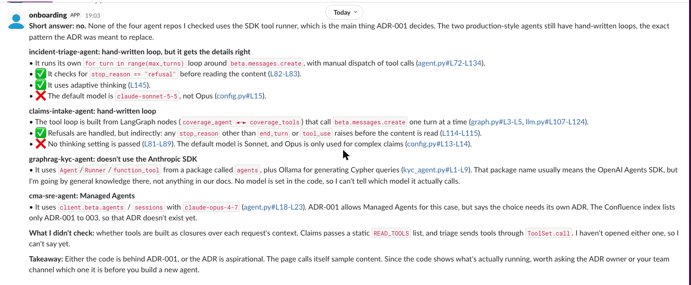
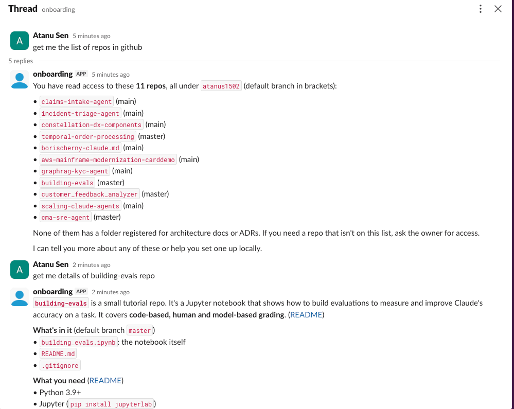
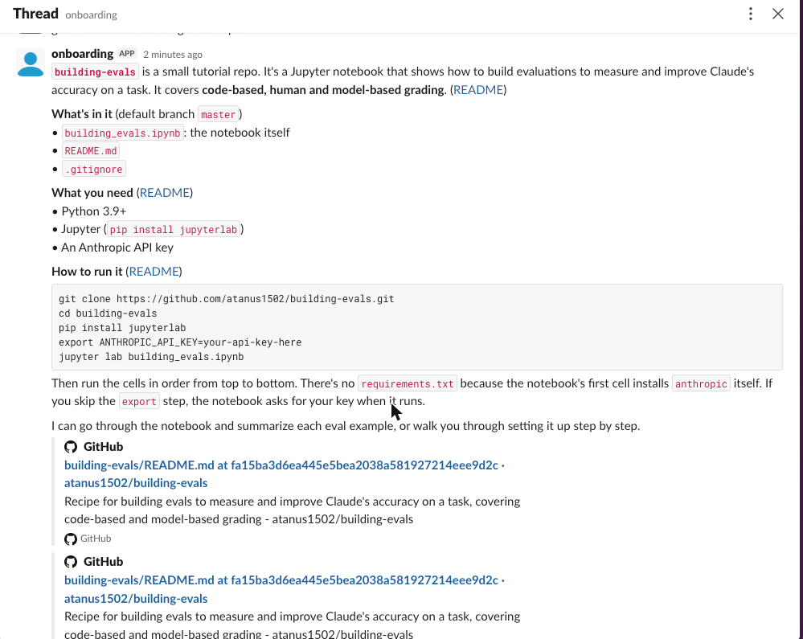
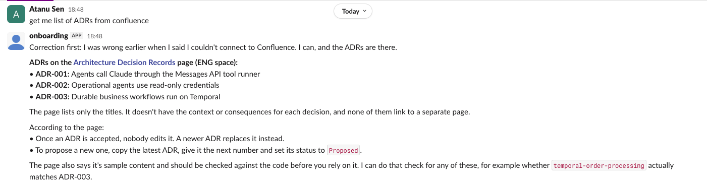
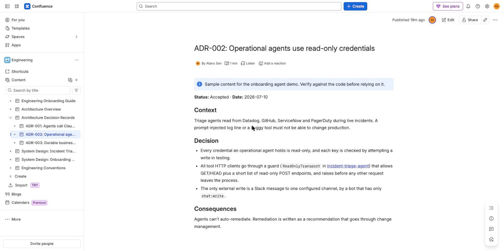

# dev-onboarding-agent

[](https://github.com/atanus1502/dev-onboarding-agent/actions/workflows/ci.yml)
[](LICENSE)


A Slack agent that answers new engineers' questions from your **GitHub repos** and **Confluence
wiki**, linked to the exact lines and pages it used. It only sees what the asking person can see,
and walks them through local setup one checked step at a time.



*Asked "Does our code actually follow ADR-001?", it reads the decision in Confluence, checks
four repos, and links every finding to the commit and line.*

## What it does

- **Answers from your sources, with links.** Code answers link to commit-pinned line ranges;
  wiki answers link to the page. When it can't find something, it says so instead of guessing.
- **Mirrors each person's access.** Every tool call checks the asker's own GitHub repo
  permission and Confluence page permission. Checks fail closed, and missing and forbidden
  resources look the same, so it never confirms that something exists.
- **Cross-checks docs against code.** When a wiki page and the code disagree, it says so and
  treats the code as current.
- **Walks through local setup.** Repos ship `.onboarding/setup.yaml`; each step has a verify
  command, and the step passes only when the user's pasted output matches.
- **Gets measured weekly.** An eval replays real new-hire questions and fails CI on any
  permission leak, any link no tool returned, or missing expected facts.

## How it works

```
Slack DM / @mention ─► OnboardingAgent ─► Claude (tool runner)
                          │                 search_code · read_file · list_directory
                          │                 search_wiki · read_wiki_page
                          │                 get_setup_guide · check_setup_step
                          ▼
              PermissionChecker (asker's GitHub + Confluence access, fail closed)
```

Design, permission model and deployment notes: [docs/onboarding-agent.md](docs/onboarding-agent.md).

## Quick start

Requires Python 3.12+ and [uv](https://docs.astral.sh/uv/).

```sh
uv sync
cp .env.example .env                                  # Anthropic, GitHub, Slack, Confluence
cp config/sources.example.yaml config/sources.yaml    # repos and wiki spaces to answer from
cp config/identities.example.yaml config/identities.yaml   # Slack user -> GitHub / Atlassian
uv run onboarding-agent doctor --as <slack-user-id>   # checks everything; costs no tokens
```

Then try it from the terminal, or run it in Slack:

```sh
uv run onboarding-agent ask --as <slack-user-id> "How do I run incident-triage-agent locally?"
uv run onboarding-agent serve                         # Socket Mode; no public URL needed
```

Create the Slack app from [config/slack-manifest.yaml](config/slack-manifest.yaml). Confluence
is optional; without it the agent answers from GitHub only.

## Run it as a container

Socket Mode connects out to Slack, so the container needs no open port or public URL.

```sh
docker build -t dev-onboarding-agent .
docker run -d --name onboarding-agent --restart unless-stopped \
  --env-file .env \
  -v "$PWD/config:/app/config:ro" \
  -v onboarding-data:/data \
  dev-onboarding-agent
```

`/data` keeps setup progress and the question log (used by `onboarding-agent mine`) across
restarts. For long-running deployments, use a GitHub App rather than a personal token; see
[deployment notes](docs/onboarding-agent.md#deploying).

## Commands

| Command | What it does | Model cost |
|---|---|---|
| `onboarding-agent doctor [--as ID]` | Checks config, credentials and one user's access | None |
| `onboarding-agent ask --as ID "…"` | One question from the terminal | One agent run |
| `onboarding-agent serve` | Runs the Slack app | Per question |
| `onboarding-agent eval` | Runs `evals/questions.yaml` and grades the answers | Agent + judge per case |
| `onboarding-agent mine --days 7` | Exports recent real questions as eval candidates | None |

## Screenshots

| | |
|---|---|
|  |  |
| Lists the repos you can read, then summarizes one | Setup steps from the README, with links |
|  |  |
| Pulls architecture decisions from Confluence | The source pages in Confluence |

The Confluence pages shown are sample content created for this demo.

## Development

```sh
uv run ruff check --fix . && uv run ruff format .
uv run mypy src
uv run pytest            # no network or credentials needed
```

See [CONTRIBUTING.md](CONTRIBUTING.md) for the ground rules, and [SECURITY.md](SECURITY.md) to
report a vulnerability.

## License

[MIT](LICENSE)
